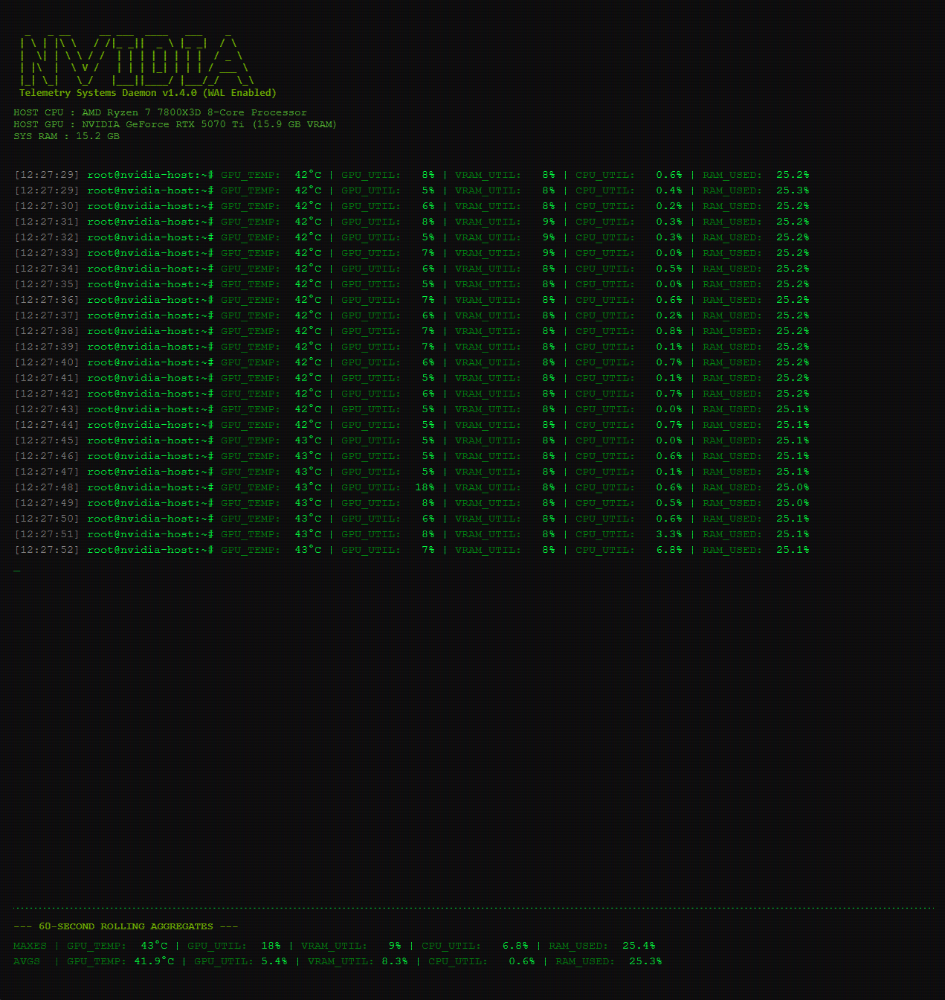
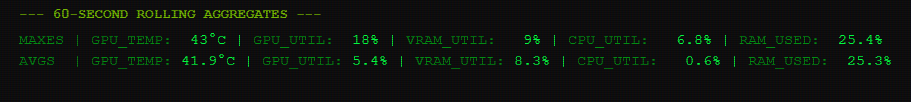
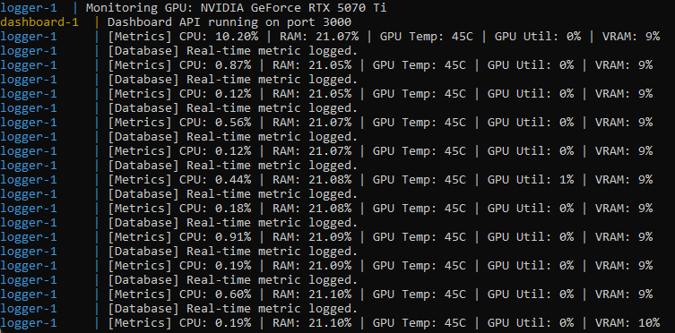

# Full-Stack C++ Systems Telemetry Daemon

An end-to-end systems monitoring daemon and full-stack web application built to capture, log, and visualize low-level hardware metrics (CPU, RAM, GPU, VRAM). Engineered in C++ using Linux virtual filesystems and NVIDIA's NVML C API to maintain <2% CPU overhead, completely orchestrated via Docker Compose with GPU hardware passthrough.

## 📸 Project Showcase

### Dynamic CRT Terminal Interface
A custom-built, retro-styled React frontend featuring live hardware identification, 1Hz polling, and parallel column alignment for real-time metric visualization.



### 60-Second Rolling Aggregations
The Node.js REST API executes real-time SQLite queries to calculate and serve rolling maximums and averages over a 60-second window, decoupling read/write locks to prevent UI stutter.



### Low-Level Containerized Logging
The C++ daemon runs silently in the background as a lightweight Docker container, bypassing Ring 3 limitations by querying `/proc` and `sysfs` while securely mapping NVIDIA host drivers via `--gpus all`.



## 🚀 Features

- **Low-Overhead Hardware Polling**: Direct C++ integration with the NVIDIA Management Library (NVML) and Linux `sysfs` for instantaneous telemetry without bulky Ring 0 custom drivers.
- **High-Concurrency Database**: Utilizes SQLite3 with Write-Ahead Logging (WAL) enabled, allowing the C++ daemon to write metrics at 1Hz while the Node.js API simultaneously reads them without database locking.
- **Full-Stack Orchestration**: A multi-stage Dockerfile and `docker-compose.yml` architecture that spins up the backend, database volume, and frontend in a single command.
- **Dynamic Hardware Discovery**: Automatically detects and logs host CPU model, Total System RAM, and GPU architecture dynamically on startup.

## 🛠️ Tech Stack

- **Systems & Core**: C++, NVIDIA Management Library (NVML C API), Linux `/proc` filesystem, CMake
- **Infrastructure**: Docker, Docker Compose, Multi-stage Builds, NVIDIA Container Toolkit
- **Database**: SQLite3 (WAL Mode, Transaction Batching)
- **Web & API**: Node.js, Express.js, React (Babel Standalone)

## ⚙️ How to Run Locally

### 1. Prerequisites
- A Linux environment (or Windows Subsystem for Linux - WSL2)
- An NVIDIA GPU with updated host drivers
- **Docker** and **Docker Compose** installed (with NVIDIA GPU passthrough enabled)

### 2. Clone and Launch
Because the application is fully containerized, no local C++ compilers or Node environments are required. Open a terminal and run:

```bash
git clone https://github.com/elijahbaez/linux-telemetry-logger.git
cd linux-telemetry-logger

# Build the C++ and Node containers and launch the microservices
sudo docker compose up --build
